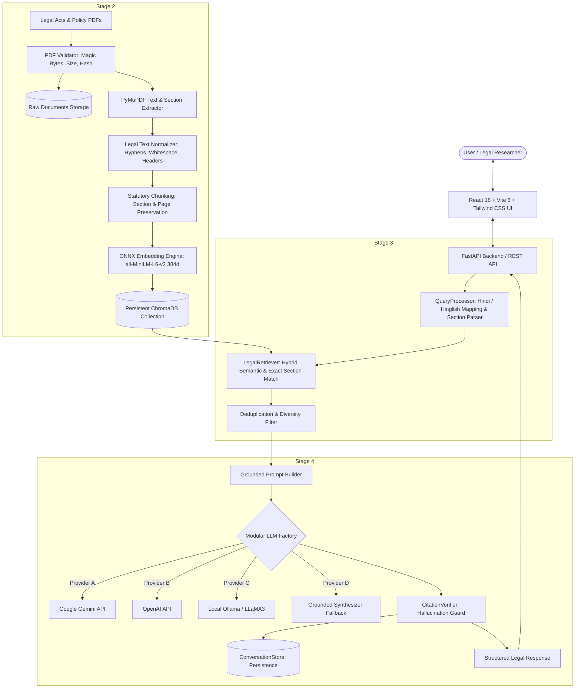

# Architecture & Design Document
## AI-Based Indian Legal & Policy Information Assistant (NyayaSathi)

---

### 1. Overview
The **Indian Legal & Policy Information Assistant (NyayaSathi)** is an enterprise-grade Retrieval-Augmented Generation (RAG) system engineered to answer legal and policy inquiries accurately using verified Indian statutory documents (Acts, Rules, Gazettes, Regulations, and Notifications).

---

### 2. High-Level System Architecture

---

### 3. Core Architectural Modules

| Component | Location | Responsibility |
| :--- | :--- | :--- |
| **API Layer** | `backend/app/api/routes.py` | FastAPI REST endpoints for Chat, Ingestion, Retrieval, Conversations, and Health. |
| **PDF Ingestion** | `backend/app/ingestion/` | Multi-step document validator, cleaner, PyMuPDF extractor, and section-aware chunker. |
| **Embedding Engine** | `backend/app/services/embedding_service.py` | Singleton dense embedding provider with ChromaDB ONNX-accelerated MiniLM runtime (384d). |
| **Vector Database** | `backend/app/database/vector_store.py` | Persistent ChromaDB client targeting `data/vector_store/`, duplicate detection via SHA-256 hash registry. |
| **Query Processing** | `backend/app/retrieval/query_processor.py` | Statutory section regex extractor, Hindi/Hinglish domain concept mapping, unsupported Act detector. |
| **Hybrid Retrieval** | `backend/app/retrieval/retriever.py` | Dense vector similarity fused with lexical token matching and exact statutory section boosting (+0.25). |
| **Modular LLMs** | `backend/app/llm/` | `BaseLLMProvider` interface with Google Gemini, OpenAI, Ollama, and Grounded Synthesizer implementations. |
| **Citation Verification** | `backend/app/services/citation_verifier.py` | Cross-verifies generated section citations against retrieved chunks, eliminating hallucinations. |
| **Conversation Storage** | `backend/app/database/conversation_store.py` | Persistent session tracking in `data/conversations.json`, retaining context for follow-up questions. |
| **Chat Service** | `backend/app/services/chat_service.py` | End-to-end pipeline coordinator connecting retrieval, grounding, generation, verification, and persistence. |
| **Frontend UI** | `frontend/src/` | React 18 + Tailwind CSS interface with Chat Window, Document Manager, Citation Cards, and Session Sidebar. |

---

### 4. Key Architectural Guarantees

1. **Zero Hallucination Policy**:
   - Answers are generated **solely** based on retrieved statutory chunks.
   - If an Act or section is absent from the indexed database, the chatbot explicitly admits: *"The requested legal statute is not currently indexed in this system."*
   - Citations (Act Name, Section, Page, Snippet) are verified against source chunks before being returned.

2. **Multilingual Query Support**:
   - Full comprehension of English, Hindi (Devanagari), and Hinglish (Romanized Hindi) legal queries.
   - Translates domain concepts (*upbhokta*, *shikayat*, *adhikar*, *aayog*, *muavza*, *dand*, *nakli*) into their statutory equivalents.

3. **Statutory Preservation & Chunking**:
   - Rather than arbitrary character chunking that splits legal clauses, chunks retain statutory boundaries (Sections, Subsections, Provisos) alongside document titles and page numbers.

4. **Modular LLM Architecture**:
   - Abstract interface `BaseLLMProvider` allows seamless swapping between Google Gemini, OpenAI, Local Ollama, and Grounded Synthesizer without code modifications.

5. **Security & Compliance**:
   - API keys kept strictly in backend `.env`.
   - File uploads validated for MIME type, size (50MB ceiling), and magic bytes.
   - Clear legal disclaimer on every query stating that responses provide educational legal information, not formal advocate representation.
